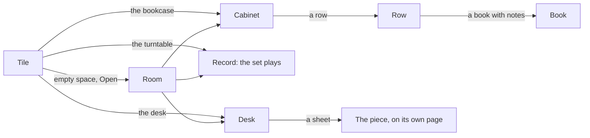

# The living room

The room is a miniature of the life the rest of the site lists: a dark library
with books, a record player and a writing desk. On the home bench it is one
tile among paper ones, the only dark object, and it should read as an object
someone made, not as a screen embedded in a page. Everything it opens is also
reachable from a plain link; the room adds depth, never access.

## How it looks

- Dark green walls, brown oak joinery, oxblood leather, a dense Persian rug.
- Warm lamps make small pools of light. The window brings cool light.
- An isometric cutaway at 4:3. The whole room stays in frame in the tile:
  sofa, bookcase, record player and desk.
- Detail that vanishes at tile size is wasted. Materials vary broadly enough
  to survive baking: the rug shifts shade in dye-lot bands, and each board has
  its own tone. Change one material family per pass, and keep it only if it
  shows at tile size on desktop.
- Its colours are art, not interface. They live as `manuscript-*` and `lamp-*`
  reference tokens and are aliased once in `room.css`, the one place a
  component uses reference colours directly.

## How it behaves

One rule: **what glows can be clicked.** Nothing is drawn over the scene except
the tile's own label and its "Open" link. No buttons, rings or arrows on the
render.

| When | The visitor sees |
|---|---|
| Resting | Each clickable thing breathes a low lamplight, out of step with the others |
| Pointed at, or focused | Full lamplight, a pointer, then a small name tag |
| Music playing | The turntable stays lit, and the tile header says "Now playing" |
| At the shelves, music playing | The record plays on, quieter and duller, as if from across the room |
| A book with notes | Its jacket breathes on the shelf |

Each thing answers with a small physical tell: the tonearm lifts toward the
record, a book leans out of its row, a manuscript lifts off its pile.

### Two sizes, one room

The room lives in the tile and opens large. It is one scene that moves between
the two, so whatever is happening carries over.

- **In the tile**, the room is live and glows. Clicking a thing opens the room
  large and does that thing: the bookcase flies to the shelves, the record
  player plays the set, the desk goes to the manuscripts. Clicking empty space
  opens the room at its overview.
- **Opened**, the room fills the screen and every interaction works.

Stepping back inside the opened room: click empty space, press Escape, or use
the browser's Back, one level at a time. From the overview, Escape or Close
returns the room to its tile.

### Moving along the shelves

| | Desktop | Phone |
|---|---|---|
| Along a row | Swipe the trackpad sideways, or drag | Swipe sideways |
| To another row | Scroll, or click a row peeking in above or below | Swipe up or down |
| Back out | Click empty space, Escape, Back | Swipe down past the top row, pinch, Back |

The first row a visitor reaches drifts toward what lies past its edge and
springs back. That is the only sign that it goes on.

## What must stay true

- The page works without the room. If it cannot render, the tile is the poster
  with plain links to Reading, Writing and the set on SoundCloud. The book list
  lives at `/reading`, never inside the room.
- Every clickable thing is a real link or button. Keyboard focus lights it and
  names it at once.
- With reduced motion, the light holds still and nothing drifts. Labels still
  appear.
- A phone downloads the 3D room only after a tap; that first tap opens it large.
- A new clickable thing joins the glow. It does not get a button of its own.

`bun run room:check chromium` and `bun run record:check` assert these
behaviours. Change the scene through [the room workflow](./room-workflow.md).
